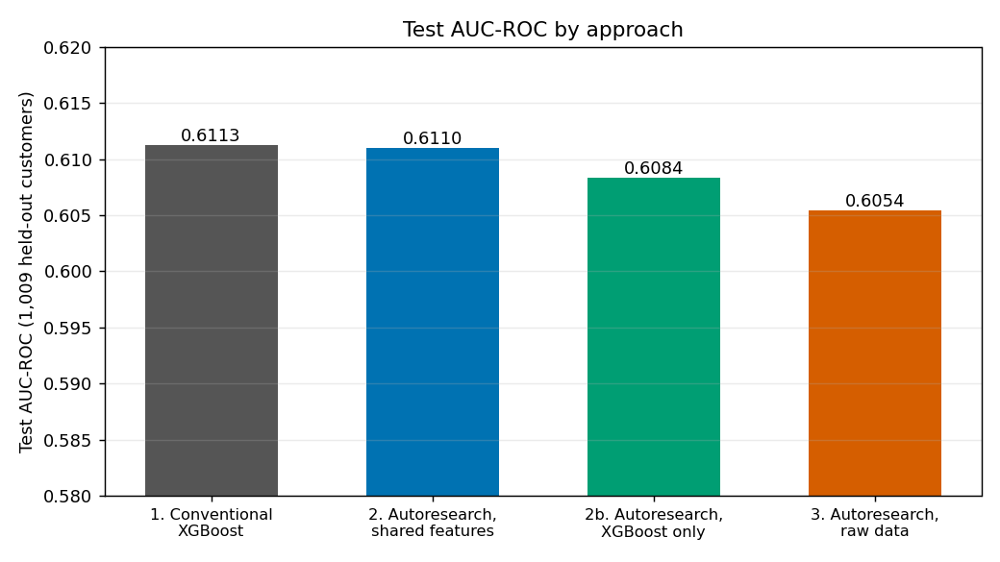
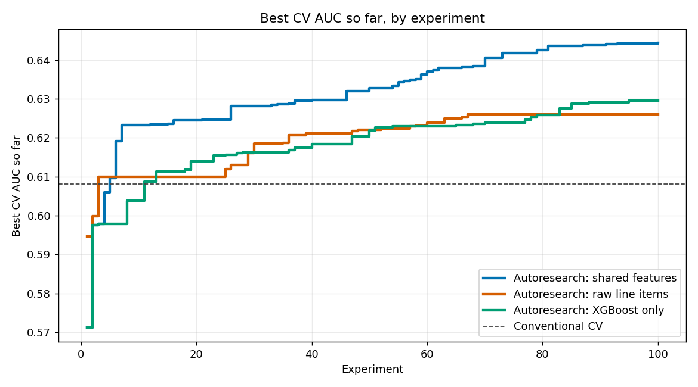

# Testing Autoresearch on E-Commerce Churn

A benchmarking project that compares **Andrej Karpathy's autoresearch framework** against a **traditional XGBoost pipeline** on an e-commerce customer churn dataset.

## Motivation

Traditional ML workflows require significant manual effort: hand-crafted features, iterative hyperparameter searches, and researcher intuition guiding each step. Karpathy's autoresearch proposes automating much of this loop — hypothesis generation, feature discovery, and model refinement — through an agentic research process. This project measures whether that automation translates into better predictive performance with less human effort.

## Approaches Compared

Four pipelines are benchmarked on the same customers, the same time-ordered train/test split (4,035 train and 1,009 test customers) and the same four time-ordered CV folds, so the held-out test metrics are comparable. The autoresearch agents run exactly 100 experiments each, with no git commits, and never see the test set.

| | 1. Conventional | 2. Autoresearch, shared features | 2b. Autoresearch, shared features, XGBoost only | 3. Autoresearch, raw data |
|---|---|---|---|---|
| Status | Done | Done | Done | Done |
| Directory | `conventional_approach/`, `src/xgboost_tuning.py` | `autoresearch/` | `autoresearch_xgboost_only/` | `autoresearch_raw_data/` |
| Input | `data/processed/train.csv` and `test.csv` (hand-built features from `src/`) | The same `train.csv` and `test.csv` as approach 1 | The same as approach 2 | First-invoice line items (`data/processed/raw_train.csv` and `raw_test.csv`, built from the original Online Retail II file) |
| Model | XGBoost | Any model the agent chooses | XGBoost models only (blends allowed) | XGBoost only |
| Feature engineering | Manual (the `src/` pipeline) | Agent builds on top of the shared features | Agent builds on top of the shared features | Agent builds every feature from the line items |
| Churn label and split | Hand-built | Supplied (same as 1) | Supplied (same as 1) | Supplied (same customers and folds as 1) |
| Hyperparameter tuning | Optuna TPE, 100 trials, time-ordered CV | Agent-driven, same time-ordered CV | Agent-driven, same time-ordered CV | Agent-driven, same time-ordered CV |
| Researcher effort | High | Low | Low | Low |

**Approach 1, Conventional.** Hand-engineered customer features (`src/`), then XGBoost tuned with Optuna against mean AUC-ROC over four expanding-window, time-ordered folds, fitted on the full training set and evaluated once on the test set. Output: `results/conventional_xgboost.json`.

**Approach 2, Autoresearch on the shared features.** An LLM agent edits `autoresearch/train.py` in a keep-or-discard loop, scored by the same four folds. It tests how much an agent adds on top of the conventional feature set. The agent may change the model family; its best model ended up as a recency-weighted bagged logistic regression, not XGBoost. See `autoresearch/README.md`. Output: `results/autoresearch_shared_features.json`.

**Approach 2b, Autoresearch on the shared features, XGBoost only.** The same setup as approach 2, but the model must be XGBoost (blends of XGBoost models are allowed). It separates the effect of the agent's feature and tuning work from the effect of being free to change the model. See `autoresearch_xgboost_only/README.md`. Output: `results/autoresearch_xgboost_only.json`.

**Approach 3, Autoresearch on raw data.** The agent starts from the line items of each customer's first invoice instead of the engineered features, and has to build every feature itself. The churn label and the train/test customer split are given. It tests whether an agent can replace the hand-built feature pipeline, not just improve on it. See `autoresearch_raw_data/README.md`. Output: `results/autoresearch_raw_data.json`.

## Results

### Test AUC-ROC by approach

The final score of each approach on the held-out test set (1,009 customers), evaluated once after tuning:

| Rank | Approach | Test AUC-ROC | Difference from conventional |
|---|---|---|---|
| 1 | 1. Conventional XGBoost | 0.6113 | n/a |
| 2 | 2. Autoresearch, shared features | 0.6110 | -0.0003 |
| 3 | 2b. Autoresearch, shared features, XGBoost only | 0.6084 | -0.0029 |
| 4 | 3. Autoresearch, raw data | 0.6054 | -0.0059 |



The ranking is not meaningful: with 1,009 test customers, differences of a few thousandths of AUC are within the noise, and each approach is a single run. The bar chart's axis starts at 0.58, so the bars exaggerate the gaps.

### Full results

| Approach | Best CV AUC | Test AUC-ROC | Test F1 | Features |
|---|---|---|---|---|
| 1. Conventional XGBoost | 0.6082 | 0.6113 | 0.5904 | 173 |
| 2. Autoresearch, shared features | 0.6443 | 0.6110 | 0.6259 | 180 |
| 2b. Autoresearch, shared features, XGBoost only | 0.6296 | 0.6084 | 0.5283 | 160 |
| 3. Autoresearch, raw data | 0.6260 | 0.6054 | 0.4724 | 7 |

CV AUC is the mean validation AUC-ROC over the four time-ordered folds, the score the agents optimised. Test AUC-ROC is the single score on the held-out test set and is the number to compare. F1 uses a fixed 0.5 threshold, so it is not directly comparable between models.



The autoresearch runs started from a CV AUC of 0.5712 (approaches 2 and 2b) and 0.5947 (approach 3), and improved it by 0.03 to 0.07 over 100 experiments.

- **No approach clearly won on the test set.** All four are within 0.006 of each other (0.605 to 0.611), which is within the noise for 1,009 test customers.
- **The CV gains did not carry over.** The autoresearch runs gained 0.018 to 0.036 over the conventional CV score, but their test AUC is no better. The best-of-100 selection on the same folds probably fitted the validation folds. The conventional approach's CV score predicted its test score well.
- **Raw data was competitive with 7 features.** The agent built its own features from the line items and reached a test AUC within 0.006 of the others.
- Each approach is one run, so the differences should not be read as a ranking. Wall-clock time per agent run was not recorded.

## Dataset

**[Online Retail II](https://archive.ics.uci.edu/dataset/502/online+retail+ii)**
from the UCI Machine Learning Repository (Daqing Chen, Chen et al. 2012).

Transactional records from a UK-based, registered non-store online retailer covering 2009-12-01 to 2011-12-09. Roughly 1.07M rows, one row per line item on an invoice. The dataset **does not include a churn label** — churn is defined downstream from the transactional history: **churn = 1** if a customer makes no second purchase within 90 days of their first purchase (or no second purchase at all), else 0. Customers whose first purchase is within the last 90 days of the data are dropped because their label cannot yet be known (`src/prepare_churn_data.py`).

| Column | Description |
|---|---|
| `Invoice` | Invoice number (6-digit). Prefixed with `C` for cancellations. |
| `StockCode` | Product (item) code. |
| `Description` | Product name. |
| `Quantity` | Units of the product per transaction line. Negative for cancellations/returns. |
| `InvoiceDate` | Invoice date and time. |
| `Price` | Unit price in pounds sterling (£). |
| `Customer ID` | 5-digit customer number. May be missing for guest / non-attributed transactions. |
| `Country` | Country where the customer resides. |

## External References

- Autoresearch by Andrej Karpathy: [github.com/karpathy/autoresearch](https://github.com/karpathy/autoresearch)
- XGBoost adaptation of autoresearch (Pafka and Ariño de la Rubia): [github.com/szilard/xgboost-autoresearch](https://github.com/szilard/xgboost-autoresearch)
- Dataset: [UCI Machine Learning Repository — Online Retail II](https://archive.ics.uci.edu/dataset/502/online+retail+ii)

## Project Structure

```
testing_autoresearch/
├── data/                   # raw/ (git-ignored) and processed/ (git-ignored)
├── src/                    # data cleaning, feature engineering, split, and xgboost_tuning.py
├── conventional_approach/  # Approach 1: notebook calling src/xgboost_tuning.py
├── autoresearch/           # Approach 2: agent harness, train.py, program.md, results.tsv, research-log.md
├── autoresearch_xgboost_only/  # Approach 2b: same as 2 with an XGBoost-only rule
├── autoresearch_raw_data/  # Approach 3: agent on raw first-invoice line items
├── results/                # Metrics as JSON and the results chart
└── README.md
```

## Reproducing Results

1. Clone the repository and install dependencies: `pip install -r requirements.txt`
2. Download the dataset into `data/raw/` (see `data/README.md`).
3. Build the data (each script reads the previous one's output):
   ```bash
   python src/prepare_churn_data.py      # first transactions + churn label
   python src/correct_data_issues.py     # data-quality corrections
   python src/build_modelling_dataset.py # one row per customer
   python src/split_data.py              # time-ordered train/test + PCA
   ```
4. Approach 1: run `conventional_approach/xgboost_model.ipynb` (logic in `src/xgboost_tuning.py`).
5. Approach 2: see `autoresearch/README.md`. After the loop, run `python autoresearch/final_eval.py --tag <tag> --n-experiments 100`.
6. Approach 2b: see `autoresearch_xgboost_only/README.md` (same `final_eval.py` usage).
7. Approach 3: run `python autoresearch_raw_data/build_data.py` once, then see `autoresearch_raw_data/README.md` (same `final_eval.py` usage).
8. Compare the JSON files in `results/`.

## Goals

- Quantify autoresearch's improvement over a traditional approach (AUC-ROC, F1, precision/recall)
- Measure researcher time-to-result for each approach
- Identify which parts of the ML pipeline autoresearch improves most
